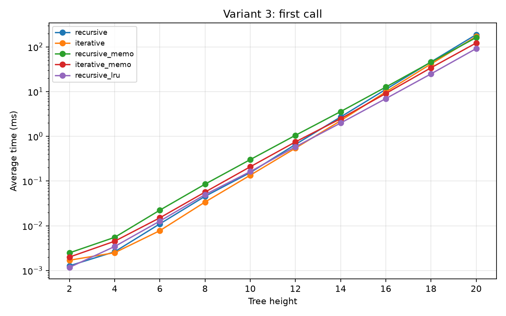
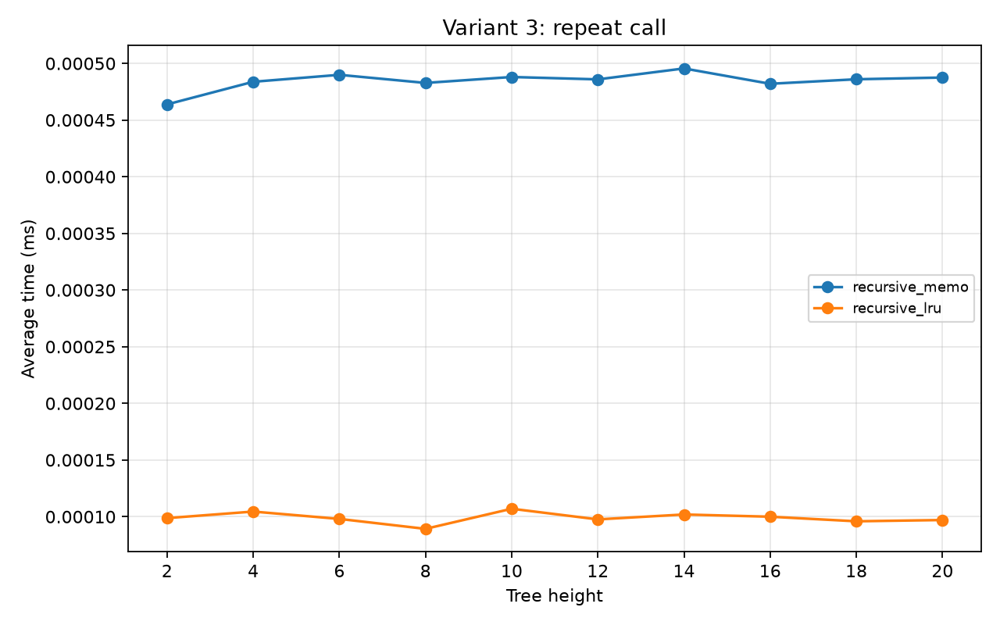
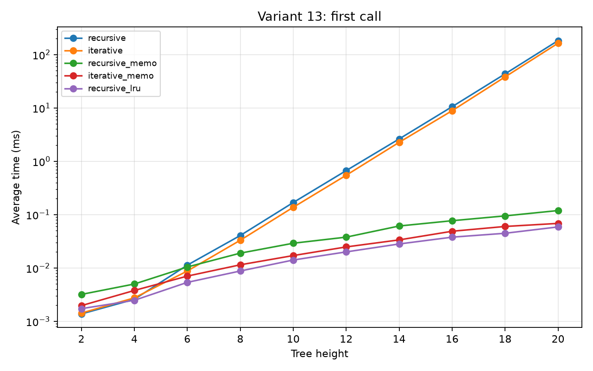
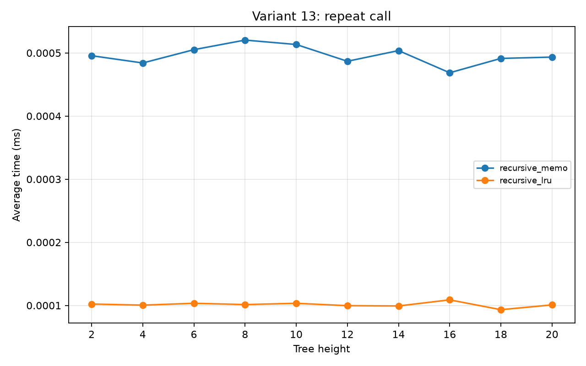

# Лабораторная работа № 5 — мемоизация бинарного дерева

**Вариант студента: 3.** Сравнение: вариант 13. Репозиторий продолжает работы № 3 и № 4. Узел дерева представлен словарём с ключами `value`, `left`, `right`; корень считается первым уровнем. Для варианта 3 значения по умолчанию: `root=3`, `height=4`, левый потомок `x + 2`, правый потомок `x * 3`. Для варианта 13: `root=13`, `height=3`, левый потомок `x + 1`, правый потомок `x - 1`.

## Файлы и запуск

- `tree_memo.py` — пять реализаций и собственный декоратор `memoize`.
- `test_tree_memo.py` — тесты `unittest`.
- `benchmark.py` — воспроизводимое измерение с `timeit` и построение графиков с `matplotlib`.
- `results.csv` — все результаты времени; `operation_counts.csv` — число вычислений потомков и обращения к кэшу.
- `figures/` — четыре графика для двух вариантов и двух сценариев.

```bash
python3 -m pip install -r requirements.txt
python3 -m unittest -v
python3 benchmark.py
```

Нужен Python 3.9 или новее. Для запуска дерева и тестов сторонние пакеты не нужны; `matplotlib` требуется только для графиков. При прямом запуске `python3 tree_memo.py` программа выводит `cache_info()` встроенного `lru_cache`.

## Реализации

| Имя | Способ построения | Кэш |
|---|---|---|
| `gen_bin_tree_recursive` | рекурсия | нет |
| `gen_bin_tree_iterative` | очередь `collections.deque` | нет |
| `gen_bin_tree_recursive_memo` | рекурсия, вызывающая декорированную функцию | собственный `memoize` между вызовами |
| `gen_bin_tree_iterative_memo` | очередь | локальный словарь `(значение, оставшаяся высота)` на время одного вызова |
| `gen_bin_tree_recursive_lru` | рекурсия | `functools.lru_cache(maxsize=None)` между вызовами |

Собственный `memoize` строит ключ из `*args` и отсортированных `**kwargs`, сохраняет имя и документацию функции через `functools.wraps` и предоставляет `cache_clear()`, `cache_hits`, `cache_misses`. Перед каждой независимой временной пробой кэш очищается.

## Методика измерения

Измерялись одинаковые высоты **2, 4, …, 20** для обоих вариантов. Высоты из условия (4 и 3) используются как значения по умолчанию функций, но для сравнения явно передаются все высоты из диапазона. Для каждой точки сделано **5 повторов**, ниже приведено среднее время. В сценарии первого построения каждый раз очищается межвызовный кэш. В сценарии повторного вызова дерево сначала строится, затем измеряется вызов с теми же аргументами; этот сценарий применим только к рекурсивным версиям с межвызовным кэшем. Для уменьшения шума повторный вызов измеряется по 1000 раз, и время делится на 1000. Верхняя граница 20 выбрана потому, что обычное построение даже на ней заняло менее 1 секунды за один вызов (в таблице максимум 0,189 секунды). Результаты зависят от компьютера и версии Python.

### Первое построение, среднее время в миллисекундах

**Вариант 3**

| Высота | Рекурсивный | Итеративный | Свой кэш, рек. | Свой кэш, итер. | `lru_cache`, рек. |
|---:|---:|---:|---:|---:|---:|
| 4 | 0,003 | 0,002 | 0,006 | 0,005 | 0,003 |
| 8 | 0,046 | 0,034 | 0,085 | 0,057 | 0,050 |
| 12 | 0,659 | 0,544 | 1,054 | 0,752 | 0,584 |
| 16 | 11,233 | 9,867 | 12,649 | 9,102 | 6,992 |
| 20 | 188,716 | 171,239 | 162,035 | 122,592 | 91,895 |

**Вариант 13**

| Высота | Рекурсивный | Итеративный | Свой кэш, рек. | Свой кэш, итер. | `lru_cache`, рек. |
|---:|---:|---:|---:|---:|---:|
| 4 | 0,003 | 0,003 | 0,005 | 0,004 | 0,002 |
| 8 | 0,041 | 0,033 | 0,019 | 0,011 | 0,009 |
| 12 | 0,668 | 0,546 | 0,038 | 0,025 | 0,020 |
| 16 | 10,538 | 8,865 | 0,077 | 0,049 | 0,038 |
| 20 | 182,499 | 163,187 | 0,119 | 0,068 | 0,059 |

Полная таблица для всех десяти высот: [results.csv](results.csv).

### Повторный вызов с теми же аргументами

При высоте 20 среднее время для варианта 3: собственный рекурсивный кэш **0,488 мкс**, `lru_cache` **0,097 мкс**. Для варианта 13: **0,493 мкс** и **0,101 мкс** соответственно. В этом сценарии возвращается уже готовое дерево; эти числа не являются временем его построения.

### Число вычислений потомков при высоте 16

| Вариант | Построение | Вызовы `left_leaf` | Вызовы `right_leaf` | Попадания / промахи кэша |
|---:|---|---:|---:|---:|
| 3 | без кэша | 32767 | 32767 | — |
| 3 | свой рекурсивный кэш | 17883 | 17883 | 2831 / 32936 |
| 3 | свой итеративный кэш | 17883 | 17883 | локальный словарь |
| 13 | без кэша | 32767 | 32767 | — |
| 13 | свой рекурсивный кэш | 120 | 120 | 105 / 136 |
| 13 | свой итеративный кэш | 120 | 120 | локальный словарь |

Для `lru_cache` числа вызовов потомков и попаданий/промахов равны соответствующим числам собственного рекурсивного кэша. Например, для варианта 13 и высоты 16 `cache_info()` показывает `hits=105, misses=136, currsize=136`. Полные данные: [operation_counts.csv](operation_counts.csv).

## Графики

Ось X — высота дерева, ось Y — среднее время в миллисекундах. На графиках первого построения использована логарифмическая шкала Y, чтобы были видны и быстрые, и медленные реализации.

| Вариант | Первое построение, все пять реализаций | Повторный вызов, два межвызовных кэша |
|---|---|---|
| 3 |  |  |
| 13 |  |  |

## Выводы

1. **Ускорение различается из-за количества одинаковых поддеревьев.** При высоте 20 собственная рекурсивная мемоизация ускорила первое построение варианта 3 примерно в **1,2 раза** (188,716 / 162,035), а варианта 13 примерно в **1532 раза** (182,499 / 0,119). В варианте 13 операции `+1` и `-1` быстро приводят к одним и тем же значениям на одинаковой глубине. В варианте 3 правила `+2` и `*3` создают намного больше разных значений.
2. **На малых высотах кэш может замедлять построение.** Для варианта 3 собственная рекурсивная мемоизация медленнее обычной на высотах 2–16 из измеренного диапазона, а на высоте 18 результаты почти равны; для варианта 13 — медленнее на высотах 2 и 4, а около высоты 6 результаты близки. Создание ключа, поиск в словаре и работа декоратора стоят времени, которое окупается только при достаточном числе повторов.
3. **Важно, куда поставлен декоратор.** Выражение `memoize(gen_bin_tree_recursive)` само по себе оборачивает только внешний вызов. Внутри исходная функция вызывает глобальное имя `gen_bin_tree_recursive`, поэтому её внутренние рекурсивные вызовы идут мимо нового обёрточного объекта. При `@memoize` над определением самой рекурсивной функции её глобальное имя указывает на обёртку, и внутренние вызовы тоже проходят через кэш.
4. **Свой `memoize` и `lru_cache` дают одинаковое дерево, но разную скорость.** При высоте 20 для варианта 3 встроенный `lru_cache` занял 91,895 мс против 162,035 мс у собственного декоратора. Встроенная реализация оптимизирована, а собственная каждый раз создаёт и проверяет Python-кортеж с отсортированными `kwargs` и обновляет счётчики. На повторном вызове различие особенно заметно. Абсолютные числа зависят от запуска.
5. **Новая `lambda` при каждом вызове мешает межвызовному кэшу.** Функции с одинаковым текстом, созданные как две отдельные `lambda`, являются разными объектами. Они входят в ключ кэша, поэтому повторный вызов с новыми `lambda` не попадает в сохранённый результат предыдущего вызова. Для повторного использования надо передавать те же объекты функций.
6. **Общие узлы опасны при изменении дерева.** В варианте 13 при высоте 3 `tree["left"]["right"] is tree["right"]["left"]` истинно для мемоизированных версий. Изменение `value` в одном месте меняет и другое место. У рекурсивного межвызовного кэша изменение дерева влияет также на следующий вызов с теми же аргументами. Это проверено тестами. Если дерево нужно менять независимо в каждом месте, лучше не делить изменяемые словари: использовать неизменяемые узлы либо создавать отдельные копии для каждого использования. Копирование только корня не устраняет внутреннее совместное использование.

Использование кэша также увеличивает расход памяти: сохранённые поддеревья остаются доступными, пока кэш не очищен. Для честных измерений и освобождения памяти используйте `cache_clear()`.
